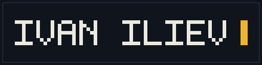

  

  ICT at HZ University of Applied Sciences · Vlissingen, NL

I'm Ivan. I like things that open in one file, start instantly, and do something you can watch.

Most of what I make is a game or a toy. **[driftblock](https://github.com/Vanishonko/driftblock)** is a blocky 3D
drift racer with no build step and no assets — the circuits, the engine note and the particles are all generated at
runtime. **[ai-f1-racing](https://github.com/Vanishonko/ai-f1-racing)** trains a driver with evolution strategies on
a deterministic 2D sim, then lets you watch it lap. **Pip** is a 32×32 creature that lives in the corner of a chat
window and reacts to what you're typing.

The rest is tooling. I build plugins for [DeepSeek Harness](https://github.com/deepseek-ai/deepseek-harness) under
[@dsh-works](https://github.com/dsh-works): a pixel-art surface that draws, looks at its own drawing and draws again,
and an alerts bell that tells you what the turn cost.

## How I build

- **One file beats a toolchain.** If a `<script>` tag can ship it, it ships.
- **Generated beats downloaded.** Circuits, sounds, sprites — written at runtime, not imported.
- **Offline is a feature.** No telemetry, no CDN, no build server.
- **Small and finished** beats large and abandoned.

---

  <a href="https://ivaniliev.online">ivaniliev.online</a> ·
  <a href="https://www.linkedin.com/in/ivan-iliev-931511221/">LinkedIn</a> ·
  <a href="mailto:vanishonko@gmail.com">vanishonko@gmail.com</a>

